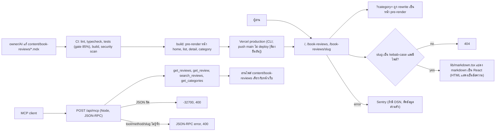

# 01 — Business process (As-Is / To-Be)

content-bookreviews-web คือสมุดบันทึกรีวิวหนังสืออ่านอย่างเดียว (Next.js, bookreviews.bookchaowalit.com) ที่อ่านรีวิว 3 เรื่องจากไฟล์ใน `content/book-reviews/` ให้ผู้เยี่ยมชม portfolio และให้ client MCP อ่านข้อมูลชุดเดียวกัน ไม่มีบัญชี ฐานข้อมูล หรือการเขียนข้อมูล

Last reviewed: 2026-11-28 · commit `d0044f2`

## As-Is (จากโค้ดวันนี้)

Sources: `lib/mdx.ts`, `lib/markdown.tsx`, `app/api/mcp/route.ts`, `lib/mcp-tools.ts`, `next.config.ts`, `app/book-reviews/[slug]/page.tsx`, `lib/sentry.ts`, `.github/workflows/ci.yml`, `README.md`, `PRODUCT.md`

หมายเหตุ: `PRODUCT.md` (2026-10-23) ระบุว่า Vercel Git link ยังชี้ชื่อรีโปเก่า จึง deploy ด้วย CLI เท่านั้น; ไม่มีไฟล์ใน repo ที่ยืนยันสถานะปัจจุบัน [ต้องยืนยัน]

## To-Be

ไม่มี To-Be ที่เขียนไว้ (`PRODUCT.md` ระบุเฉพาะสิ่งที่ยังไม่ทำและห้ามอ้าง เช่น reading-status, search UI ไม่มีเป้าหมายใหม่)

## Gap

| ID | As-Is → To-Be | Status | Owner | Evidence |
|---|---|---|---|---|
| G1 | ไม่มี To-Be ของกระบวนการ → owner กำหนดว่าจะเพิ่มความสามารถใด (เช่น search UI, สถานะการอ่าน) หรือคงเป็น ledger อ่านอย่างเดียว | decide | owner | ไม่มีใน `PRODUCT.md` / `specs/` |
| G2 | push เข้า main ไม่ deploy (Vercel Git link ชี้รีโปเก่า) → ผูก Vercel Git กับรีโปปัจจุบัน | decide | owner | `PRODUCT.md` §Live URL and deploy state (owner action D9) |

## Open questions

- Production รัน commit ไหนในตอนนี้ และ Git link ถูกแก้แล้วหรือยัง
